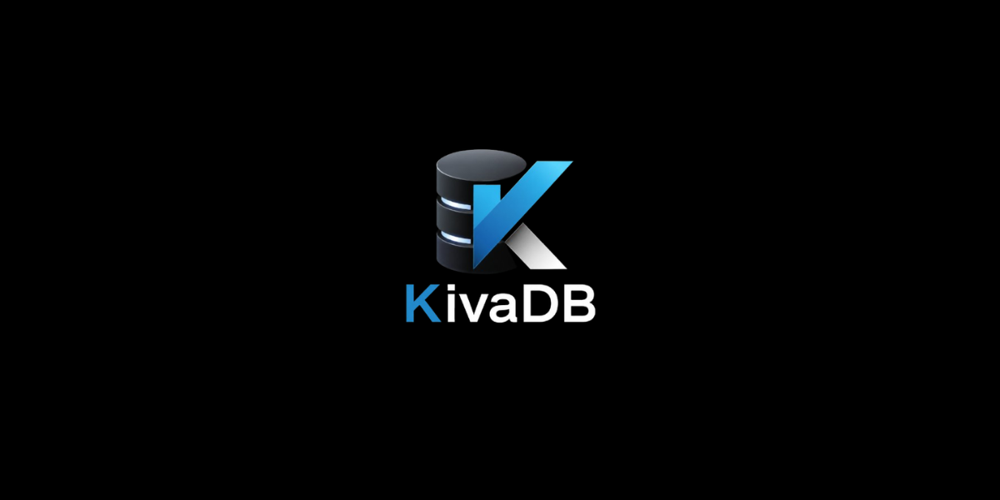

<p align="center">
  
</p>

# KivaDB

KivaDB is a multi-model database you can start in one command: typed key-value data, documents with indexes and queries, and vector search for AI, in a single executable written in Rust. You organise it in projects and collections, and talk to it from its shell, from any language (its own protocol, the Redis protocol, or HTTP), or from Kiva Studio, its desktop application.

**Current release: 2.0.0** &nbsp;|&nbsp; **[Read the full documentation → DOCUMENTATION.md](DOCUMENTATION.md)** &nbsp;|&nbsp; **[What is new in 2.0](DOCUMENTATION.md#what-is-new-in-20)** &nbsp;|&nbsp; **[Upgrading from 1.x](DOCUMENTATION.md#chapter-33--upgrading-from-kivadb-1x-to-20)**

## What it does

* **Stores typed data**: strings, exact numbers (`int`, `float`, `decimal`), dates, times and datetimes with time zones, booleans, null, arrays, documents and raw bytes. Documents keep the type of every value inside them, and random values and UUIDs are drawn by the database.
* **Organises it**: a collection is an independent database, a project groups the collections of one application (`shop.orders`, `shop.users`), and each account reaches only the collections or projects it is granted.
* **Keeps it safe**: every record is checksummed, a crash or a killed process loses no answered write, and transactions are atomic, tested by stopping the process at every step of a commit. A data file damaged on disk is refused, never opened in part, and `kivadb doctor` checks a whole home without changing it.
* **Finds it fast**: keys are kept sorted (range queries, pagination); documents are filtered with `and`, `or`, `not` and parentheses, `in [...]`, `like` and `ilike` (any case), sorted with `order by` (or drawn with `order by random()`), served by sorted or hash indexes that the planner combines (`explain analyze` shows what a query read), and folded into aggregates (`count`, `sum`, `avg`, `min`, `max`, `group by`).
* **Keeps it consistent**: unique indexes, on one field or a combination of fields and optionally ignoring case, refuse a duplicate whoever writes it, even two clients at the same instant; `add place: {...}` names a new key with an identifier in MongoDB's ObjectId format. Applications [coming from MongoDB](DOCUMENTATION.md#249-coming-from-mongodb) find each operation's counterpart there.
* **Understands AI embeddings**: `get similar doc:*.embedding to [...]` finds the closest documents (cosine, dot or Euclidean), with in-memory vector indexes: exact, or HNSW for large collections, optionally quantized to one byte per number, filtered on other fields during the search, and tuned on your data (`tune vector index ... auto` keeps it tuned as it grows). A **semantic cache** gives back the answer of a question already asked in other words, so that a language model is not called twice, and drops it as soon as the data it `depends` on changes.
* **Speaks Redis**: applications and libraries written for Redis connect to port 6379 unchanged (RESP2 and RESP3): strings, counters, expiry to the millisecond, hashes, lists, sets, sorted sets, streams with consumer groups, blocking commands (`BLPOP`, `XREAD BLOCK`...), transactions with `WATCH`, JSON documents (`JSON.*`), vector search (`KIVA.SIMILAR`), Lua scripts (`EVAL`), publish/subscribe and numbered databases. Checked with ioredis, node-redis, rate-limiter-flexible and rate-limit-redis.
* **Tells what changed**: a change journal per collection, read again from a cursor by the programs that mirror the data, expirations included; live notifications over WebSocket and Server-Sent Events.
* **Runs as a service**: `kivadb start` puts the database in the background on port **2911**; shells, programs, the REST API (port 8080, with WebSocket and Server-Sent Events) and Redis clients (port 6379) all work on the same live data.
* **Scripts in files**: commands can span several lines, and `.kva` files hold commands to run with `kivadb run data.kva`, from the shell or from Kiva Studio.
* **Replicates and fails over**: replicas follow the master live, every collection included; with `failover.auto`, they elect a new master by majority when it dies, and the old one steps down when it returns.
* **Backs up in one command**: `kivadb backup -o all.tar.gz` while it runs, `kivadb restore all.tar.gz` after checking every SHA-256; `kivadb export` and `import` move one collection as NDJSON.
* **Encrypts its data at rest** (AES-256-GCM): records, index snapshots and vector graphs, with a key kept outside the data folder, key rotation, and `kivadb keygen`.
* **Encrypts its connections**: TLS on every port (shell, Kiva Studio, drivers, HTTPS, `rediss://`), with a certificate it creates itself and checks by fingerprint like SSH, or your own.
* **Grows with you**: users and roles, an optional in-memory value cache, compression, Lua scripts and triggers, Prometheus metrics and a readiness probe, a Docker image, and official Node.js and Python drivers.

## Install

| Way | How |
| :--- | :--- |
| **Windows** (PowerShell) | `irm https://raw.githubusercontent.com/fomadev/kiva-db/main/install.ps1` &#124; `iex` |
| **Linux, macOS** | `curl -sSL https://raw.githubusercontent.com/fomadev/kiva-db/main/install.sh` &#124; `bash` |
| **Download** | Get the archive for Windows, Linux or macOS from the [releases page](https://github.com/fomadev/kiva-db/releases), unpack it, put `kivadb` in your `PATH` |
| **Docker** | `docker run -d --name kivadb -e KIVADB_ADMIN_PASSWORD=a-long-secret -p 2911:2911 -p 8080:8080 -p 6379:6379 -v kivadb-data:/data fomadev0/kiva-db:2.0.0` |
| **From source** | Install [Rust](https://rustup.rs) and a C compiler (used once, for the embedded Lua), then `cargo build --release`; the executable is `target/release/kivadb` |

Step-by-step instructions for each system are in [Chapter 1](DOCUMENTATION.md#chapter-1--installation) of the documentation.

## Five-minute tour

Start the database, then open a shell:

```bash
kivadb start
```

```bash
kivadb
```

```text
kiva> set name "Fordi" and age 30
OK: name saved.
OK: age saved.
kiva> set user:1 {"name": "Alice", "role": "admin", "address": {"city": "Kinshasa"}}
OK: user:1 saved.
kiva> get user:1.address.city
user:1.address.city: Kinshasa [string]
kiva> count where user:*.role = "admin"
Count: 1
kiva> print "Next year ${name} will be ${age + 1}"
Next year Fordi will be 31
```

An application gets a project, with a collection per kind of data:

```text
kiva> project create shop collections (orders, users)
kiva> use shop.orders
Using collection 'shop.orders' (0 keys).
kiva[shop.orders]> add order: {"total": decimal "149.90", "day": date "2026-11-24"}
```

The same data, from a program or the command line:

```bash
curl http://localhost:8080/v1/key/user:1
```

```text
kivadb status     is the database running?
kivadb stop       stop it
kivadb update     install the latest release
kivadb run x.kva  run a file of commands
kivadb backup -o all.tar.gz   save everything, even while it runs
kivadb --help     every option
```

Type `help` inside the shell for the list of commands.

Prefer a window? **[Kiva Studio](https://fomadev.github.io/projects/kiva-studio/)** is the desktop client for Windows, Linux and macOS: data browser, query builder, similarity search, users and server health.

## Hierarchy preview and layout export

Use `kivadb --hierarchy-preview` for the administrative hierarchy preview.
`workspace help`, `project help`, and `collection help` document its commands.
For an offline staged migration, `kivadb migrate layout-plan` shows where its
collections would fit in the managed layout. See the
[offline export procedure](docs/architecture/WORKSPACE_HIERARCHY.md#physical-layout-export).

## Documentation

Everything is explained step by step, with examples, in **[DOCUMENTATION.md](DOCUMENTATION.md)**, written so that someone who has never used a database can start at Chapter 0.

| If you want to... | Read |
| :--- | :--- |
| Install KivaDB and get going from zero | [Part I, Chapters 0 to 3](DOCUMENTATION.md#chapter-0--introduction) |
| Learn the commands: data, documents, queries, vectors, transactions | [Part II, Chapters 4 to 13](DOCUMENTATION.md#chapter-4--syntax-rules) |
| Administer it: collections and projects, configuration, users, maintenance | [Part III, Chapters 14 to 19](DOCUMENTATION.md#chapter-14--collections-and-projects) |
| Connect an application: protocol, REST, notifications, Redis, drivers | [Part IV, Chapters 20 to 24](DOCUMENTATION.md#chapter-20--the-tcp-server) |
| Replication, Lua scripts, monitoring, embedding in Rust | [Part V, Chapters 25 to 28](DOCUMENTATION.md#chapter-25--replication) |
| Host it: Linux, Windows, macOS, Docker | [Part VI, Chapter 29](DOCUMENTATION.md#chapter-29--deploying-kivadb-on-a-server) |
| Fix a problem, look a command up | [Troubleshooting](DOCUMENTATION.md#chapter-30--troubleshooting), [cheat sheet](DOCUMENTATION.md#chapter-31--command-cheat-sheet) |

## Project layout

| Path | Contents |
| :--- | :--- |
| `src/` | The database: storage engine, command language, servers (KivaDB protocol, REST, Redis), replication, scripting |
| `tests/` | Automated tests (storage, commands, network, Redis, vectors, encryption, backups, failover, semantic cache) - run them with `cargo test` |
| `drivers/node/` | The official Node.js driver (npm package `@fomadev/kivadb`) |
| `drivers/python/` | The official Python driver (package `kivadb`) |
| `examples/nodejs/` | A dependency-free Node.js client, to read the protocol |
| `benches/` | The benchmarks: one version against another, and the query planner |
| `docs/` | How 2.0 was designed, measured and tested ([docs/README.md](docs/README.md)) |
| `Dockerfile`, `docker-compose.yml` | The Docker image and a ready-to-use Compose file |
| `.github/workflows/` | Tests on Windows, Linux and macOS; releases and the Docker image on every version tag |
| `DOCUMENTATION.md` | The complete manual |
| `CHANGELOG.md` | What each version changed |
| `ROADMAP.md` | What comes next, and what was set aside and why |
| `CONTRIBUTING.md` | How to contribute |

## Scope of this release

KivaDB 2.0.0 stores the whole database on each node, with replicas and automatic failover. Clustering (spreading the data over several machines) and SQL / the PostgreSQL protocol are not part of it; [ROADMAP.md](ROADMAP.md) explains what comes next and why.

## License

This repository is published under and protected by the **[Fordima Public License (FPL)](LICENSE)**.

* **Binary Utilization**: Permissions are granted to execute compiled KivaDB CLI binaries within personal, academic, and industrial production environments free of charge.
* **Source Modification**: Redistribution, compilation, or integration of source fragments into third-party commercial applications or competitive data frameworks requires an official paid licensing agreement.
* **Contributions**: Forks are exclusively permitted for creating pull requests targeting the primary branch of the official repository.
