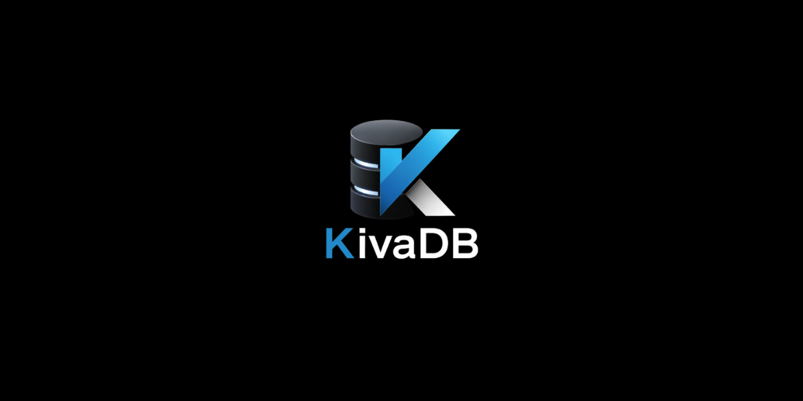

<p align="center">
  
</p>

# KivaDB

KivaDB is a multi-model database you can start in one command: typed key-value data, JSON documents with indexes and queries, and vector search for AI, in a single executable written in Rust. You talk to it from its shell, from any language (its own protocol, the Redis protocol, or HTTP), or from Kiva Studio, its desktop application.

**Current release: 1.3.0** &nbsp;|&nbsp; **[Read the full documentation → DOCUMENTATION.md](DOCUMENTATION.md)**

## What it does

* **Stores typed data**: strings, numbers, booleans, null, arrays, objects (JSON documents) and raw bytes.
* **Keeps it safe**: every record is checksummed, a crash or a killed process loses nothing, and transactions are atomic.
* **Finds it fast**: keys are kept sorted (range queries, pagination), documents can be filtered, counted, summed and indexed.
* **Understands AI embeddings**: `get similar doc:*.embedding to [...]` finds the closest documents (cosine, dot or Euclidean), with in-memory vector indexes.
* **Speaks Redis**: applications and libraries written for Redis connect to port 6379 unchanged (RESP2 and RESP3): strings, counters, expiry, hashes, lists, transactions, Lua scripts (`EVAL`) and numbered databases. Checked with ioredis, node-redis, rate-limiter-flexible and rate-limit-redis.
* **Runs as a service**: `kivadb start` puts the database in the background on port **2911**; shells, programs, the REST API (port 8080, with WebSocket and Server-Sent Events) and Redis clients (port 6379) all work on the same live data.
* **Encrypts its connections**: TLS on every port (shell, Kiva Studio, drivers, HTTPS, `rediss://`), with a certificate it creates itself and checks by fingerprint like SSH, or your own.
* **Grows with you**: users and roles, isolated workspaces, an optional in-memory value cache, compression, replication to other machines, Lua scripts and triggers, change notifications, Prometheus metrics, Docker image, official Node.js driver.

## Install

| Way | How |
| :--- | :--- |
| **Windows** (PowerShell) | `irm https://raw.githubusercontent.com/fomadev/kiva-db/main/install.ps1` &#124; `iex` |
| **Linux, macOS** | `curl -sSL https://raw.githubusercontent.com/fomadev/kiva-db/main/install.sh` &#124; `bash` |
| **Download** | Get the archive for Windows, Linux or macOS from the [releases page](https://github.com/fomadev/kiva-db/releases), unpack it, put `kivadb` in your `PATH` |
| **Docker** | `docker run -d --name kivadb -e KIVADB_ADMIN_PASSWORD=a-long-secret -p 2911:2911 -p 8080:8080 -p 6379:6379 -v kivadb-data:/data fomadev0/kiva-db:1.3.0` |
| **From source** | Install [Rust](https://rustup.rs) and a C compiler (used once, for the embedded Lua), then `cargo build --release`; the executable is `target/release/kivadb` |

Step-by-step instructions for each system are in [Chapter 1](DOCUMENTATION.md#chapter-1--installation) of the documentation.

## Five-minute tour

Start the database, then open a shell:

```bash
kivadb start
```

```bash
kivadb
```

```text
kiva> set name "Fordi" and age 30
OK: name saved.
OK: age saved.
kiva> set user:1 {"name": "Alice", "role": "admin", "address": {"city": "Kinshasa"}}
OK: user:1 saved.
kiva> get user:1.address.city
user:1.address.city: Kinshasa [string]
kiva> count where user:*.role = "admin"
Count: 1
kiva> print "Next year ${name} will be ${age + 1}"
Next year Fordi will be 31
```

The same data, from a program or the command line:

```bash
curl http://localhost:8080/v1/key/user:1
```

```text
kivadb status     is the database running?
kivadb stop       stop it
kivadb update     install the latest release
kivadb --help     every option
```

Type `help` inside the shell for the list of commands.

Prefer a window? **[Kiva Studio](https://github.com/fomadev/kiva-studio)** is the desktop client for Windows, Linux and macOS: data browser, query builder, similarity search, users and server health.

## Documentation

Everything is explained step by step, with examples, in **[DOCUMENTATION.md](DOCUMENTATION.md)**, written so that someone who has never used a database can start at Chapter 0.

| If you want to... | Read |
| :--- | :--- |
| Install KivaDB and get going from zero | [Part I, Chapters 0 to 3](DOCUMENTATION.md#chapter-0--introduction) |
| Learn the commands: data, documents, queries, vectors, transactions | [Part II, Chapters 4 to 13](DOCUMENTATION.md#chapter-4--syntax-rules) |
| Administer it: workspaces, configuration, users, maintenance | [Part III, Chapters 14 to 19](DOCUMENTATION.md#chapter-14--workspaces) |
| Connect an application: protocol, REST, notifications, Redis, drivers | [Part IV, Chapters 20 to 24](DOCUMENTATION.md#chapter-20--the-tcp-server) |
| Replication, Lua scripts, monitoring, embedding in Rust | [Part V, Chapters 25 to 28](DOCUMENTATION.md#chapter-25--replication) |
| Host it: Linux, Windows, macOS, Docker | [Part VI, Chapter 29](DOCUMENTATION.md#chapter-29--deploying-kivadb-on-a-server) |
| Fix a problem, look a command up | [Troubleshooting](DOCUMENTATION.md#chapter-30--troubleshooting), [cheat sheet](DOCUMENTATION.md#chapter-31--command-cheat-sheet) |

## Project layout

| Path | Contents |
| :--- | :--- |
| `src/` | The database: storage engine, command language, servers (KivaDB protocol, REST, Redis), replication, scripting |
| `tests/` | Automated tests (storage, commands, network, Redis, vectors) - run them with `cargo test` |
| `drivers/node/` | The official Node.js driver (npm package `kivadb`) |
| `examples/nodejs/` | A dependency-free Node.js client, to read the protocol |
| `Dockerfile`, `docker-compose.yml` | The Docker image and a ready-to-use Compose file |
| `.github/workflows/` | Tests on Windows, Linux and macOS; releases and the Docker image on every version tag |
| `DOCUMENTATION.md` | The complete manual |
| `ROADMAP.md` | What comes next, and what was set aside and why |
| `CONTRIBUTING.md` | How to contribute |

## Scope of this release

KivaDB 1.3.0 is a single-node database with replicas. Automatic leader election, clustering, SQL / the PostgreSQL protocol and approximate vector indexes are not part of it; [ROADMAP.md](ROADMAP.md) explains what comes next and why.

## License

This repository is published under and protected by the **[Fordima Public License (FPL)](LICENSE)**.

* **Binary Utilization**: Permissions are granted to execute compiled KivaDB CLI binaries within personal, academic, and industrial production environments free of charge.
* **Source Modification**: Redistribution, compilation, or integration of source fragments into third-party commercial applications or competitive data frameworks requires an official paid licensing agreement.
* **Contributions**: Forks are exclusively permitted for creating pull requests targeting the primary branch of the official repository.
